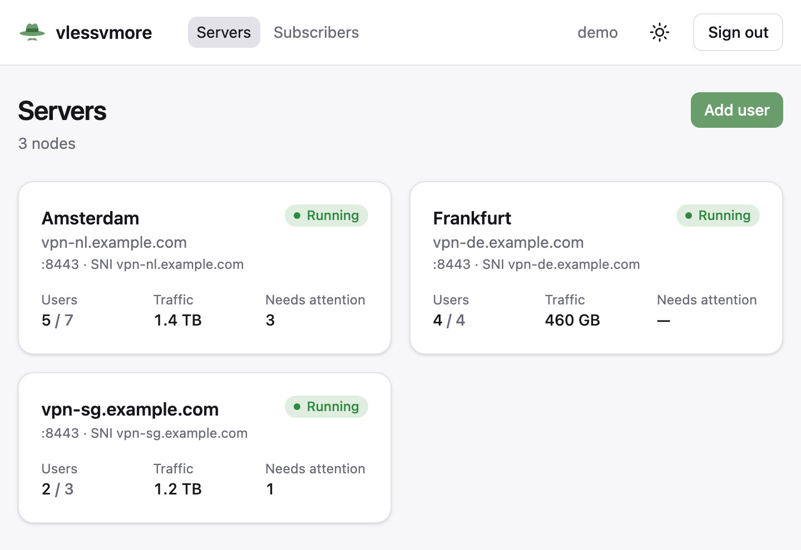
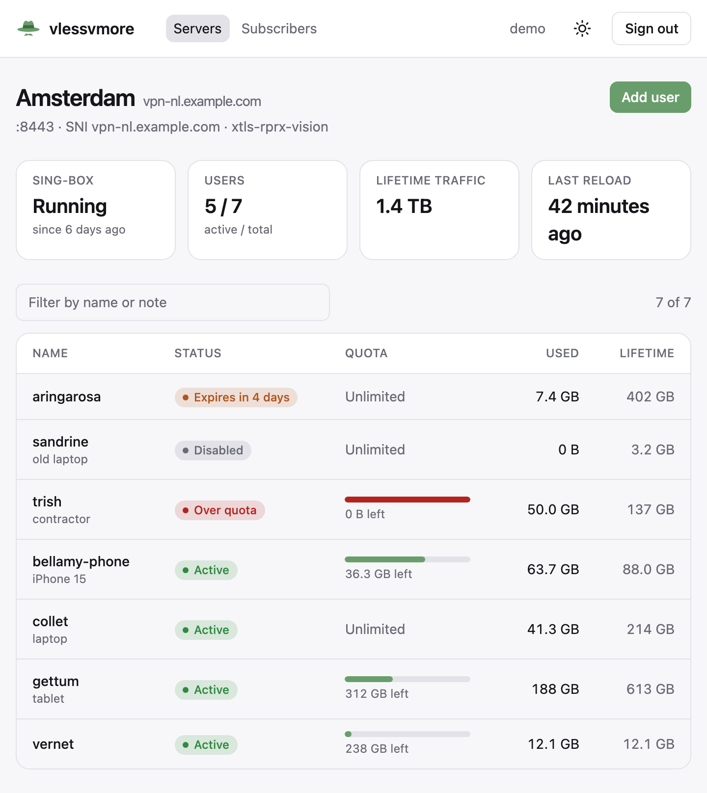
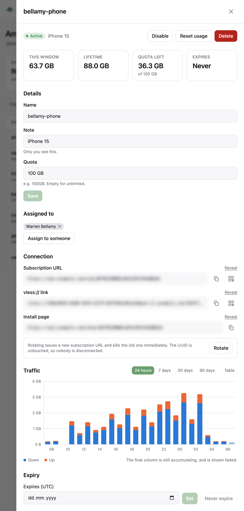
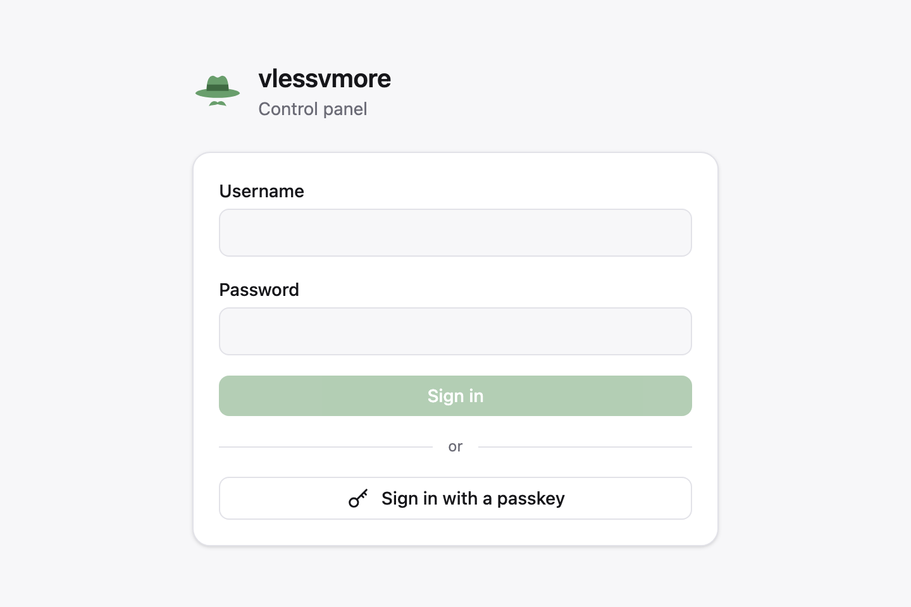
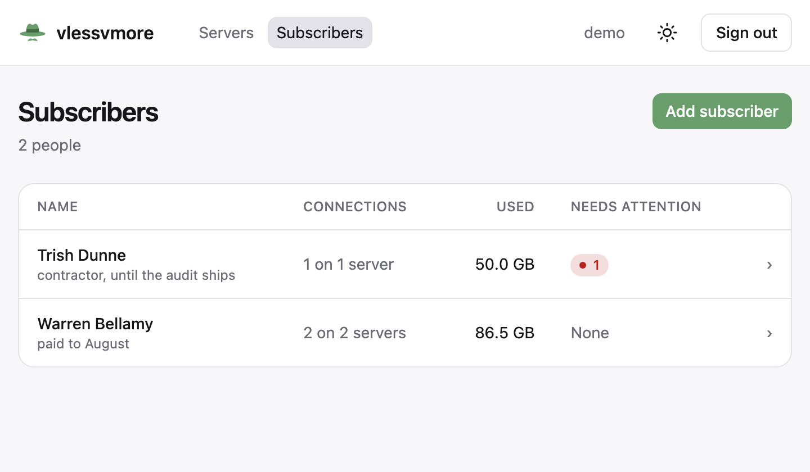
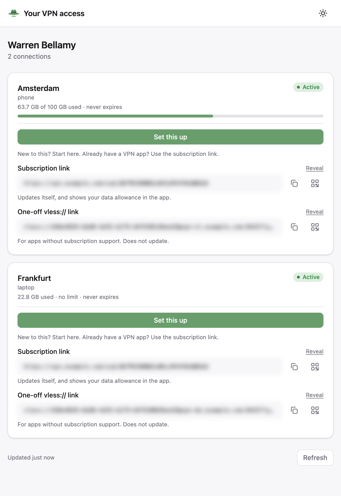

# vlessvmorectl

A web control panel for one or more [vlessvmore](https://github.com/reeywhaar/vlessvmore)
servers.

vlessvmore has a complete management API but no interface, so everything is
`docker exec vlessvmore vlessvmore user add alice` or a hand-rolled `curl`. Running more
than one node means logging into each host separately, and there is nowhere to see usage
across all of them. This is that missing piece: a login, an overview of every node, and
the user management you would otherwise do at a shell — links, QR codes, subscription
URLs, quotas, expiry and traffic history.

It also answers the other half of that problem: **giving a person one link.** Group the
accounts somebody holds — on any number of nodes — under a *subscriber*, and they get a
single URL showing all of them, with QR codes, subscription links and how much data they
have left. No login, and no panel: it is a separate page with its own bundle.

It holds no VPN state of its own. Every node remains the source of truth for its own
users; this only asks and tells.

<p align="center">
  
  
</p>
<p align="center">
  
  
</p>
<p align="center">
  
  
</p>

Real captures of the panel; only the data is invented. Regenerate them with
[`docs/screenshots/capture.sh`](docs/screenshots/capture.sh).

## Contents

- [How it fits together](#how-it-fits-together) — the proxy, and why a browser never holds a node token
- [Install](#install) — mint a token, `docker compose up`, create the first administrator
- [Configuration](#configuration) — one environment variable that matters
- [The CLI](#the-cli) — panel logins; VPN users live on the nodes
- [Your own account](#your-own-account) — changing your username and password from the panel
- [Passkeys](#passkeys) — signing in without a password, and the one variable that enables it
- [Subscribers, and the page you hand them](#subscribers-and-the-page-you-hand-them) — one link per person, and what that link is worth
- [Backups](#backups) — the panel posts its own archives to a backup agent
- [fail2ban](#fail2ban) — one log line per refused password, passkey or share link
- [Things worth knowing](#things-worth-knowing) — silent reload failures, quota counters, capability URLs
- [Security](#security) — what keeps `/api/proxy` from being a liability
- [Development](#development) — tests, and where the 7 MB goes
- [Not implemented](#not-implemented) — including one thing that never will be

## How it fits together

```
                    ┌──────────────────────────────────────────┐
  operator ────────▶│ vlessvmorectl  :80                       │
       cookie       │  POST /api/login                         │
   vlessvmore_auth  │  POST /api/passkeys/login/…              │  ← no session yet
                    │  GET  /api/me                            │
                    │  GET  /api/servers  → [{id, url}]        │  ← no tokens
                    │  ANY  /api/proxy?url=…                   │
                    │  ANY  /api/subscribers…                  │
                    │  ANY  /api/account/…                     │
                    │  ANY  /api/passkeys…                     │
                    │  the panel bundle                        │
                    │                                          │
  subscriber ──────▶│  GET  /access/{token}                    │  ← no session
       no cookie    │  GET  /api/access/{token}                │
                    │  a separate bundle                       │
                    └───────────────┬──────────────────────────┘
                                    │  Authorization: Bearer <token>
                                    ├──▶ https://vpn-nl.example.com/api/*
                                    └──▶ https://vpn-de.example.com/api/*
```

**The browser never receives a bearer token.** It asks this service to make each call and
this service attaches the credential. That is the central design decision, and it buys
four things:

- A full-control token for every VPN node never sits in a laptop's memory, so an XSS —
  including one arriving through a compromised npm dependency — cannot exfiltrate them.
- There is no `cors_origins` to configure and remember on every node. A forgotten one
  would otherwise fail as a browser CORS error that leaves no trace in any log you own.
- **No node's management API has to be reachable from the internet at all.** The panel can
  reach them over a private Docker network.
- Go sees the real transport error — DNS, refused, TLS, timeout — where a browser making
  the same cross-origin request only ever gets an opaque `TypeError`. The panel's error
  messages are accurate rather than guessed.

The cost is that this service is now a single point of connectivity: a node reachable from
your browser but not from this host is unmanageable. See [Not implemented](#not-implemented).

## Install

```sh
# On each vlessvmore node, mint a token for the panel. Shown once, never again.
docker exec vlessvmore vlessvmore token create panel --raw
```

```sh
# Here
mkdir -p data
cp .env.example .env      # put the url|token pairs in it
docker compose up -d

# Nobody can sign in until an administrator exists. There is deliberately no way to
# create the first one from the web — that would be a race against whoever reaches the
# URL first — so a shell on this host is the bootstrap credential.
docker exec vlessvmorectl vlessvmorectl users add alice
```

Then open the panel and sign in.

### compose

No `docker-compose.yml` ships with this repo; it is four lines of yours plus this:

```yaml
services:
  vlessvmorectl:
    image: ghcr.io/reeywhaar/vlessvmorectl:latest
    container_name: vlessvmorectl
    restart: unless-stopped

    # The tokens must not live in a committed file.
    env_file: .env

    volumes:
      # admins.json, sessions.json and subscribers.json. Without this mount every
      # administrator disappears when the container is replaced — and the only way back
      # in is a shell on this host — and every share link stops working.
      - ./data:/var/lib/vlessvmorectl

    healthcheck:
      test: ["CMD", "vlessvmorectl", "healthcheck"]
      interval: 30s
      timeout: 5s
      start_period: 5s
      retries: 3

    networks:
      - caddy

    labels:
      # This service issues session cookies and proxies credentialed calls. Terminate TLS
      # in front of it.
      caddy: panel.example.com
      caddy.reverse_proxy: "{{upstreams 80}}"
      caddy.log.output: stdout
      caddy.log.format: json

networks:
  caddy:
    external: true
```

Nothing is published to the host: Caddy dials the container directly. If you would rather
run it standalone, add `ports: ["127.0.0.1:8080:80"]` and put your own TLS in front.

**Better still**, if the panel and the nodes share a Docker network, point
`VLESSVMORE_SERVERS` at `http://vlessvmore-nl:80|TOKEN` and stop publishing each node's
management API entirely. Proxying is what makes that possible.

## Configuration

Everything is environment. There is no config file, because the only thing this program
needs to be told is which nodes it manages.

| variable | meaning |
| --- | --- |
| `VLESSVMORE_SERVERS` | comma-separated `url|token` pairs. Newlines work too. |
| `VLESSVMORE_TOKENS` | accepted as an alias for the above |
| `VLESSVMORE_LOG_LEVEL` | `debug`, `info` (default), `warn`, `error` |
| `VLESSVMORE_PASSKEY_ORIGIN` | the address operators open in a browser, e.g. `https://panel.example.com`. Enables [passkey sign-in](#passkeys); unset disables it |
| `VLESSVMORE_BACKUP_URL` | where a backup agent takes an archive, e.g. `http://backup:8080/backup`. Enables [backups](#backups); unset disables them |
| `VLESSVMORE_TRUSTED_PROXIES` | whose `X-Forwarded-For` names the caller for [fail2ban](#fail2ban): addresses, ranges, `private` (default) or `none` |
| `VLESSVMORECTL_DATA_DIR` | overrides `/var/lib/vlessvmorectl` |

```
VLESSVMORE_SERVERS="https://vpn-nl.example.com|MHDJWEZ5…,https://vpn-de.example.com|QK7M2XA9…"
```

A malformed entry, or two entries for the same node, is a startup error — that is a typo,
and the container logs are where you will look for it. **Zero servers is not an error**:
the panel comes up, you sign in, and the empty state tells you which variable to set.

The listen port is `:80` and is not configurable. Remap it with a port binding, the same
stance vlessvmore takes.

## The CLI

```
vlessvmorectl serve
vlessvmorectl users add <username> [password]
vlessvmorectl users ls [--json]
vlessvmorectl users rm <username> [-y] [--force]
vlessvmorectl users passwd <username> [password]
vlessvmorectl users rename <username> <new-username>
vlessvmorectl passkeys ls [--json]
vlessvmorectl version
```

These are *panel* logins. VPN users live on each node and are managed from the panel
itself.

Three ways to give a password:

```sh
vlessvmorectl users add alice hunter2          # warns: it is now in your shell history
vlessvmorectl users add alice                  # prompts, with echo off
echo hunter2 | vlessvmorectl users add alice --password-stdin
```

`serve` notices an out-of-band change to `admins.json` within a second, so
`docker exec … users add` takes effect on a running panel with no restart, and
`users passwd` signs that person out **everywhere, immediately** — which is the entire
point of changing a password after a suspected compromise.

`users rename` signs nobody out, not even on their other devices. An administrator has a
permanent id that a session refers to, so their username is only a label. Giving the freed
name to somebody else creates a different administrator who inherits nothing.

`users rm` refuses to remove the last administrator without `--force`, since that locks
everyone out of a running panel.

`sessions.json`, `subscribers.json` and `passkeys.json` are written only by the running panel,
never by the CLI — one writer each, which is what lets two processes share a data directory
without a lock or a socket protocol, and the CLI's handles on the last two are read-only in
code rather than by convention. `admins.json` is the one file both write, so the panel refuses
to write over a version that changed underneath it and tells you to try again.

## Your own account

Click your own name in the header. There is no nav tab for it — the header already wraps on
a phone — and the page changes two things:

**Your username.** Nobody is signed out, not even you on your other devices. An
administrator has a permanent id that sessions refer to, so the username is only a label.

**Your password.** Every *other* device is signed out; the tab you used stays signed in,
because punishing the person who just typed both passwords correctly would be the wrong
trade. Minimum eight characters, maximum 72 — bcrypt ignores anything past that, so a longer
one would let a truncated version log in too.

Only the password change asks for your current one, and it is rate limited in the same bucket
as the login endpoint. That change can lock the real owner out, so proving you are not merely
holding a borrowed session is worth the friction. A username is not a secret and changing it
grants nothing, so asking again there would be ceremony.

There is still no way to *create* the first administrator from the web, and no way to touch
somebody else's account from it. Both remain `vlessvmorectl users …` on a shell.

## Passkeys

Off unless you set one variable:

```
VLESSVMORE_PASSKEY_ORIGIN="https://panel.example.com"
```

Without it there are no passkey endpoints at all — they are not registered, so they answer
the same JSON 404 as any other unknown path — and no passkey affordance in the UI. That is
the default because WebAuthn has to be *told* which origin it is bound to, and this service
takes nothing from `Host` or `X-Forwarded-Host`: both are client-supplied, and building a
security decision out of one is how you get a panel that trusts whoever asks.

The relying party id is that origin's hostname. It is baked into every credential an
authenticator stores, so **changing the panel's hostname invalidates every passkey**. It must
be `https`, or `localhost` while developing; an IP address is refused, because WebAuthn wants
a domain and `127.0.0.1` is not one.

With it set, an administrator signs in with a password, opens their account page and adds a
passkey — Touch ID, Windows Hello, a phone, or a security key. After that the sign-in screen
offers **Sign in with a passkey**, and browsers that support it also offer the passkey from
the username field's autofill. No username is typed either way: the credential says who you
are.

Three things worth knowing before you rely on it:

- **A passkey is a second way in, not a second factor.** It stands beside the password with
  the same authority. Nothing here is two-factor authentication.
- **A passkey survives a password change.** `users passwd` ends every session, including ones
  obtained with a passkey — but it does not remove the passkey, so that person can sign
  straight back in. Revoking somebody is `users rm`.
- **`passkeys.json` holds public keys only.** Unlike `subscribers.json`, nothing in it is a
  capability: the private key never leaves the authenticator, so a leaked copy of this file
  authenticates nobody.

Removing an administrator leaves their credentials behind until the panel next starts or
somebody opens an account page, at which point they are pruned. They cannot be used in the
meantime — every sign-in re-checks `admins.json`, which is the authority on whether an account
exists. And because an administrator's id is permanent, giving a freed username to somebody
else never hands them the old passkeys.

`vlessvmorectl passkeys ls` shows what exists. There is deliberately no `passkeys rm`: the
panel rewrites that file wholesale from memory, so a second writer's edit would be silently
undone.

## Subscribers, and the page you hand them

A **subscriber** is a person, not an account. Create one, attach the VPN accounts they hold
— on any number of nodes — and copy their share link. Opening it needs no login and shows,
for each account: which server, whether it is working, how much data is left, when it
expires, the `vless://` link, the subscription URL and QR codes for both.

Attaching works from both ends, because either end can be where you are standing when the
question comes up. A subscriber's drawer lists their connections and has **Attach an
account**; a VPN user's own drawer has an **Assigned to** row that does the same in
reverse, for when you have just created an account and are already looking at it. The list
carries a per-person count of connections that need attention — out of data, expired,
switched off, deleted from its node, or on a node this panel no longer has configured — so
"who is about to complain" is answered without opening anybody.

This is the one thing the panel owns that a node does not. An attachment is a *reference*
— a node id and an account id — never a copy: nothing is snapshotted, so a subscriber
record cannot go stale, and an account deleted on a node simply shows as gone. It lives in
`subscribers.json` next to `admins.json`, written only by the running panel.

**The share page is a separate bundle**, built from its own Vite entry, with its own React
root and no router, no query client and no API dispatcher. That is a boundary rather than
an optimisation: the operator's pages are not in the module graph a subscriber's browser
loads, so keeping them out does not depend on nobody ever writing the wrong import. It does
not make the panel bundle unreachable — static files on a public origin can be fetched by
anyone who knows the name — but it decides what a stranger is *served*.

Three things worth knowing before you hand a link out:

- **The link is a capability, and it is minted once.** There is no rotate. Anyone holding it
  sees every account attached to that subscriber. If one leaks, switch the subscriber off —
  instant, reversible, and it disconnects nobody — or delete them and start again.
- **Switching a subscriber off does not disconnect anyone.** It stops the page answering.
  The accounts themselves keep working, because they live on the node and know nothing about
  this. The two revocations are independent: rotating a node's subscription token changes
  what the page *shows*, and does not invalidate the share link.
- **The token is in the URL, so it will appear in your reverse proxy's access log.** That is
  the standing cost of capability URLs — vlessvmore's own `/sub/` and `/show/` URLs have it
  too. This service keeps it out of its own logs, replacing it with a fingerprint you can
  derive from the token you hold.

## Backups

The panel takes its own copies and posts them to a backup agent. There is nothing to fetch
from it and no sidecar of ours to run: this repository used to publish a second image that
mounted the data directory and archived it hourly, and that image is gone.

Everything the panel owns is four JSON files in one directory, so an archive is a `.tgz` of
that directory and a restore is putting it back. Entries are mode `0600` under a single
top-level `data/`, named `vlessvmorectl-<YYYYMMDD_HHMMSS>.tgz`. There is no database to
quiesce — the panel writes each file by rename, so a reader always sees a whole file rather
than half of one — which is also why `restic`, Kopia or a cron job around `tar` are still
perfectly good answers if you would rather not run an agent at all.

Two things are not in it. The node tokens live in `.env`, and every VPN account lives on its
node, so an archive restores the panel — administrators, sessions, subscribers and their
share links — not the VPN.

### Where it goes

[backio-agent](https://github.com/reeywhaar/backio) takes an archive at `POST /backup` and
does the rest: naming, optional AES-256 encryption, upload to a remote, and retention on both
ends. It is somebody else's image and it is generic, which is why this repository no longer
publishes one of its own.

```
VLESSVMORE_BACKUP_URL=http://backup:8080/backup
```

**Nothing is backed up until that is set.** There is no default, because a default would be a
guess at a hostname on a network this process cannot see. A malformed one is a startup error
rather than a log line five minutes later.

### When it goes

Whenever the data directory has changed, and at most once every five minutes. Nothing here
reacts to a write, so adding six subscribers in a minute produces one archive holding all six
— the delay is a throttle as much as a delay. The first copy is taken at startup rather than
five minutes in, because a process that has just started is the one most likely to have been
restarted onto a new volume.

`sessions.json` is the exception. It travels in the archive, so a restore does not sign every
operator out, but it never decides that a copy is due: it holds cookie hashes, it is rebuilt
by everyone signing in again, and it changes on its own — a sliding refresh, a janitor sweep
— none of which is worth an archive.

Five minutes is not a setting. It trades how much of a burst becomes one archive against how
long a change sits uncopied, and it has one sensible answer on every panel this runs on.

What was last accepted is remembered in memory rather than on disk: a file recording it would
live in the directory being hashed, and every check would then find a change it had caused
itself. Losing it across a restart costs one redundant archive.

### Restoring

Restoring is extracting. Stop the panel first — it keeps `subscribers.json` in memory and
writes that copy back on the next change, so restoring underneath a running panel gets your
file overwritten again:

```sh
docker compose stop vlessvmorectl
tar xzf vlessvmorectl-20260730_031500.tgz -C .   # writes ./data/*.json
docker compose start vlessvmorectl
```

**An empty data directory is an error, not an empty archive** — that one uploads cleanly,
satisfies retention, prunes the good copies behind it, and is discovered on the day it is
needed. The likeliest cause is a mount that is not where the panel expects it.

### Together

Append this to the compose file from [Install](#compose). The panel has to reach the agent, so
add `backup-net` to its `networks:` list and `VLESSVMORE_BACKUP_URL=http://backup:8080/backup`
to its `.env`.

```yaml
  backup:
    image: ghcr.io/reeywhaar/backio-agent:latest
    container_name: vlessvmorectl-backup
    restart: unless-stopped
    networks: [backup-net]
    environment:
      BACKIO_HOST: http://backio:8080
      BACKIO_PROVIDER: gdrive
      # Remote directory. Must match the one granted to the token:
      #   docker exec backio /backio issue-token "gdrive vlessvmorectl create,read,delete"
      BACKIO_SUBDIRECTORY: vlessvmorectl
      BACKIO_TOKEN: "<issued by backio>"
      # Optional AES-256. WITHOUT THIS PASSWORD THE BACKUP IS UNRECOVERABLE — store it
      # somewhere other than the host being backed up.
      BACKUP_PASSWORD: change-me-and-store-it-safely

  # backio forwards archives to a cloud provider (Google Drive, S3, ...).
  # See https://github.com/reeywhaar/backio
  backio:
    image: ghcr.io/reeywhaar/backio:latest
    container_name: backio
    restart: unless-stopped
    volumes:
      - backio-data:/data
    networks: [backup-net]
    environment:
      # base64-encoded rclone config (e.g. from backio's ./setup-gdrive.sh)
      - RCLONE_CONF_BASE64=${RCLONE_CONF_BASE64}

networks:
  backup-net:
    driver: bridge

volumes:
  backio-data:
```

See backio-agent's own README for its retention settings and for how a token is issued. A
passphrase it encrypts with is not kept anywhere, so an archive whose passphrase is lost is
an archive nobody can open.

**What an archive is worth, if it leaks:** `admins.json` is bcrypt hashes, not passwords, and
`sessions.json` is cookie hashes, not cookies. `subscribers.json` is the sensitive one: share
tokens in the clear, each a capability granting sight of that subscriber's accounts. No node
bearer token is in there at all. Hence `BACKUP_PASSWORD` when the remote is not yours.

## fail2ban

The panel bans nobody itself. Every refused credential is one line with the caller's address:

```
time=… level=WARN msg="password refused" ip=203.0.113.7 via=sign-in
```

`via` is `sign-in`, `passkey`, `current-password`, or `share-link` for a link that is unknown or
switched off, since a share token is a password too. The line never carries a username or a
password.

```ini
# filter.d/vlessvmorectl.local
[Definition]
failregex = ^time=\S* level=WARN msg="password refused" ip=<ADDR>
ignoreregex =
```

```ini
# jail.d/vlessvmorectl.local
[vlessvmorectl]
enabled   = true
filter    = vlessvmorectl
logpath   = /path/to/vlessvmorectl.log
banaction = iptables-allports[chain=DOCKER-USER]
findtime  = 600
bantime   = 1d
maxretry  = 5
```

`logpath` is the container's log as plain lines, not Docker's JSON-wrapped `json-file` log.
`DOCKER-USER` because traffic to a published container port never passes `INPUT`.

The address is read from `X-Forwarded-For`, and only when the connection comes from a trusted
proxy, right to left up to the first hop that is not one. `VLESSVMORE_TRUSTED_PROXIES` names
them, `private` by default, which is all caddy-docker-proxy needs. A CDN in front of Caddy needs
its ranges added here and in Caddy's `trusted_proxies`, and there an iptables ban does nothing:
the CDN connects, not the caller.

## Things worth knowing

**Upgrading to this version signs everyone out once.** Administrators gained a permanent
id, and sessions now refer to it rather than to a username. Sessions saved by an older
build have no id to refer to, and inventing one from the username would be guessing, so
they are dropped on the first start and everyone signs in again. `admins.json` is rewritten
once at startup to record the new ids; the old records keep their username as their id, so
nothing else moves. Roll back after that and the old build will refuse to read the file
rather than misread it — restore `admins.json` from a backup if you need to.

**A passkey is tied to the hostname you serve the panel on.** The relying party id comes from
`VLESSVMORE_PASSKEY_ORIGIN`, and authenticators store it alongside the key, so moving the panel
to a new domain silently invalidates every enrolled passkey. Passwords still work; everyone
re-enrols.

**vlessvmore has no 401.** Every refusal it makes — no token, revoked token, unknown path,
wrong method — is an identical `404 page not found` in `text/plain`, padded to a fixed
60–150 ms, deliberately. Its genuine not-founds are JSON. That content type is the only
way to tell "your token is wrong" from "no such user", and this panel reads it: a rejected
token gets a message naming the environment variable to look at, not a shrug.

**A saved change is not necessarily a live one.** Changing a user rewrites the node's
sing-box config and reloads it, and the reload can fail on its own — the node answers 2xx
with `reloaded: false`. The panel shows a sticky banner in that case, not a toast that
disappears: an operator who has just disabled someone believes they are disconnected, and
until that clears they are not. The banner heals itself when any later reload succeeds.

**Reloads drop connections.** They are coalesced on the node, and this panel never reloads
on a timer — only when you change something, or press the retry button.

**`with_v2ray_api` or nothing.** If a node's sing-box was built without that tag there are
no per-user traffic counters at all: usage stays at zero and quotas never fire, silently.
The panel checks and says so on the server card.

**Traffic is counted in whole UTC hours**, so the newest bucket in a chart is always still
accumulating. It is drawn faded rather than as a cliff, because otherwise every graph
looks like it ends in an outage.

**Subscription and install URLs are capabilities.** Anyone holding one can connect as that
user. They are blurred until revealed, never logged, and rotating a subscription token
invalidates the old URL immediately without disconnecting anyone — the UUID is untouched.
A subscriber's share link is a capability of the same class; see
[Subscribers](#subscribers-and-the-page-you-hand-them).

**Sessions survive a restart**, so `docker compose restart` does not sign everyone out.
They live in `sessions.json` in the data directory, and what is stored is a *hash* of each
cookie value rather than the value — the same discipline vlessvmore uses for
`tokens.json`. Reading that file gets you a list of digests, not a list of credentials.
Signing out removes the record, so a revoked session does not come back from the dead
either.

**The session cookie is `Secure` only over TLS.** Making it unconditional is stricter, but
with the port fixed at `:80` its failure mode is a browser silently discarding the cookie
and a login that "succeeds" and then 401s forever, with no error anywhere. Instead a login
over plain HTTP from a non-loopback host logs a warning naming the consequence.

## Security

`/api/proxy` takes a URL from an authenticated client and fetches it with a credential
attached. That is what it is for; what keeps it from being a liability is the set of checks
around it:

- A session is required before the URL is even parsed.
- The URL's origin must be an **exact match** for a configured node — a map lookup, never
  a prefix comparison, because `https://vpn.example.com.attacker.test` has a configured URL
  as a prefix and is a domain anyone can register.
- Only `/api/` paths are proxied. `/sub/`, `/show/` and `/static/` are public capability
  URLs meant to be opened directly, so routing them through here would add reach without
  adding value.
- Only `GET`, `POST`, `PATCH`, `DELETE`.
- Redirects are never followed, so a redirect cannot carry the token off-origin.
- Request headers are an allowlist: the browser's own `Authorization` and `Cookie` never
  reach a node. Response headers are an allowlist of exactly `Content-Type`.
- Errors and logs route through a redaction helper. There are tests asserting that no
  response body and no log line ever contains a token.

`GET /api/access/{token}` is the other endpoint that makes credentialed calls to a node,
and the only one a stranger can reach. It is not a second `/api/proxy`, because **the
caller contributes zero bytes to any outbound URL**: the scheme, host, path and query are
built entirely from configuration and from what an authenticated operator put in
`subscribers.json`. The token selects a record; it cannot reach the wire. Also:

- An unknown token is answered from memory and contacts no node at all, so somebody without
  a working link cannot make this panel generate upstream traffic. There is a test asserting
  the upstream hit count is zero.
- The response is a projection with no field for a node URL, an account uuid, a `sub_token`,
  the operator's note, or any other subscriber. A leak would take somebody adding a field on
  purpose.
- Malformed, unknown and switched-off tokens produce one byte-identical 404.
- Per-token and global rate limits, with buckets created only for tokens that resolve —
  otherwise the limiter is an unbounded map keyed by attacker input.
- The token never reaches a log line: `logRequests` replaces it with a fingerprint.

Elsewhere: bcrypt at cost 12, a login rate limit per username plus a global cap (a slow
hash on an unauthenticated endpoint is a CPU amplifier), `SameSite=Lax` plus a
JSON-only-bodies rule and a `Sec-Fetch-Site` check for CSRF, `Referrer-Policy: no-referrer`
(load-bearing for share links, which carry a credential in the path), and **no CORS
middleware at all** — its absence is load-bearing, and there is a test that fails if one
appears.

`admins.json` holds only bcrypt hashes, at mode 600. `subscribers.json` holds share tokens
in the clear, also at 600, because an operator has to be able to re-read a link to send it
again — a hash cannot do that. It is not an escalation: everything a share token unlocks is
a set of node subscription URLs that are themselves capability URLs already sitting in that
person's VPN client.

On passkeys specifically:

- **Attestation is `none`.** There is no trust anchor to check an attestation statement
  against and no metadata service to consult, so requesting one would be theatre. The COSE
  public key is extracted from the attestation object either way, which is the part that
  matters.
- **A backwards signature counter is logged, not refused.** It can mean a cloned
  authenticator; it much more often means one credential synced to two devices, and refusing
  would turn that into an unexplained sign-in failure whose only recovery is a shell. There is
  a test pinning this behaviour, so a library release that starts refusing on its own shows up
  as a failing test rather than as somebody locked out.
- **User verification is `preferred`.** A passkey here carries the same authority as the
  password beside it, so requiring a PIN on a security key that has none would be an
  unexplained refusal rather than a security gain.
- **A signed-in session can enrol a passkey.** So a stolen session can plant a credential that
  outlives a password change — which is the reason `users rm` exists and the reason the
  account page lists every passkey with the date it was last used.
- Every passkey endpoint acts only on the caller's own account. There is no path to another
  administrator's credentials, so there is no authorization check to get wrong.
- The two unauthenticated sign-in endpoints share the login endpoint's global rate limit, and
  the pending-challenge table is capped with oldest-first eviction: conditional mediation means
  an anonymous visitor mints one challenge per page load.

## Development

```sh
go test ./...            # includes the proxy's security surface
gofmt -l . && go vet ./...

cd web
npm ci
npm run typecheck
npm test
npm run build            # emits web/dist, which the Go binary embeds
```

`go build` works without Node installed: `web/dist/.gitkeep` is tracked so the embed
resolves, and a binary with no bundle serves a page explaining how to build one rather
than a blank screen.

### Binary size

The binary is ~9.9 MB for `linux/amd64` (~9.2 MB for `arm64`), and the image is a little
under 30 MB. Three things get it there:

- `CGO_ENABLED=0 -trimpath -ldflags "-s -w -buildid="` — drops the symbol table, DWARF
  and build ID, and takes a plain build from 11 MB to 7.7 MB.
- The bundle is **gzipped before it is embedded** (684 KB → 224 KB), which is another
  ~450 KB off the binary and also means the compressed bytes are served straight from
  memory rather than being recompressed per request. `internal/api/spa.go` registers a
  `foo.js.gz` under `/foo.js`, so nothing downstream knows.
- A scratch-ish `alpine` runtime with only `ca-certificates`.

Passkey support accounts for 1.3 MB of that, which is what `github.com/go-webauthn/webauthn`
and its dependency graph cost. The alternative was hand-writing WebAuthn verification against
a CBOR decoder, and security code written once and maintained never is a worse liability than
four modules.

UPX would roughly halve what remains and is deliberately not used: it decompresses the
whole binary into RAM at every start, defeats page-cache sharing between containers, and
gets flagged by enough security scanners to be a support burden. For a process that
starts once and runs for months, the trade is the wrong way round.

Running the whole thing locally against a real node:

```sh
# in vlessvmore/
docker compose up -d
TOKEN=$(docker exec vlessvmore vlessvmore token create panel --raw)
docker exec vlessvmore vlessvmore user add alice

# here
go run . users add admin hunter2hunter2
VLESSVMORE_SERVERS="http://localhost:8080|$TOKEN" go run . serve   # :80

cd web && npm run dev    # :5173, proxying /api to :80 so both look same-origin
```

## Not implemented

- **A client|proxy switch.** Proxying means this host is a single point of connectivity: a
  node your browser can reach but this host cannot is unmanageable. The seams for a
  per-node toggle are already in place — `Transport` is one interface with one
  implementation, the proxy passes upstream responses through verbatim so the client's
  error handling would not fork, and `unreachable.reason` already carries the
  browser-side values (`cors`, `mixed-content`, `offline`) with UI copy written. What is
  missing is the second `Transport`, the per-node preference, and returning tokens to the
  browser for the nodes it applies to.
- **Automatic fallback** from proxy to direct. Deliberately not done, and not planned: it
  is how you end up silently shipping bearer tokens to a browser because a node blipped.
- **Passkey-only accounts.** Every administrator keeps a password, because it is the recovery
  path when a device is lost and the bootstrap credential when there is nothing else.
- **Enterprise attestation** and a metadata-service trust anchor for passkeys, which would
  need a policy nobody here wants to maintain.
- **Username-first passkey sign-in.** Only discoverable credentials are used, so an
  authenticator that cannot store one is enrolled but says so.
- Managing another administrator's passkeys. `users rm` is the whole story.
- Creating or revoking a node's API tokens from the panel.
- Editing a node's `config.json` — it is read-only operator input, by design upstream.
- Multi-user audit trails beyond the log line each change writes.
- `VLESSVMORE_SERVERS_FILE`, for reading the token list from a Docker secret rather than
  the environment (where `docker inspect` and `/proc/1/environ` can see it).
